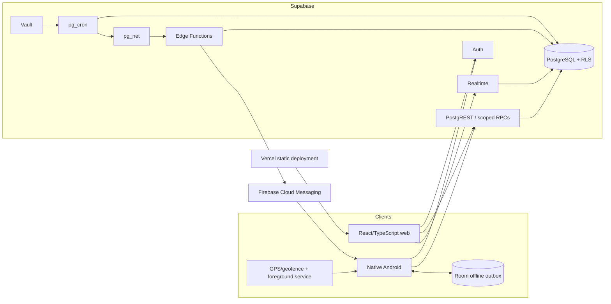

# GEOTRACK production audit — 2026-11-14

## Executive status

This audit was performed with production in read-only mode. No production
database, Vercel deployment, Firebase project, Auth setting, cron job, secret,
or employee record was changed.

| Area | Before / confirmed defect | Repository result | Production status |
|---|---|---|---|
| Geofence detector | `max(uuid)` repeatedly failed; 12,078 failed and 5,607 successful cron runs as of 2026-11-14 12:11 Arabia Standard Time | Deterministic latest-sample ordering, session scoping, accuracy handling, idempotent alerts, transition tests | Not deployed; live job remains failing |
| Device trust | Employees had table writes; unknown/revoked devices could be trusted or reactivated | Direct writes revoked, pending enrollment, admin approval/reset, audit log, device-bound attendance | Not deployed |
| Offline attendance | Permanent failures could retry forever; a legacy overload could falsely record `device_blocked` as synced | Bounded exponential retry, explicit failure classes, preserved timestamps/idempotency, visible review states, safe legacy outcome | Not deployed |
| Phone usage | Client-writable metrics and unavailable data represented as zero | Approved-device RPC, value/shift validation, explicit availability, supporting-evidence label | Not deployed |
| Notifications | Claiming a breach alert marked it pushed before FCM success; scheduler credential was embedded in cron text | Two-phase claims, stale-claim recovery, bounded retries, invalid-token cleanup, terminal-failure escalation, Vault-backed schedule | Not deployed |
| Dashboard | Trend arrays were empty and production could temporarily display demo records | Database-backed seven-day trends, timezone-aware geofence totals, explicit unavailable modules/data | Not deployed |
| CI/release | Incomplete SQL coverage and no dependency/release smoke gate | Eight SQL suites, web/Android checks, dependency review, protected read-only deployment smoke workflow | Local branch only |
| Android release | Update signer compatibility was undocumented operational risk | Release build verified as minified/non-debuggable, but local signer does **not** match deployed signer | Blocked for distribution |

## Verified deployment state

- GitHub repository: `Shaikhabdulaleem/GEOTRACK`; default branch `main`.
- GitHub `main` head: `b91b78d0eb1030106012a42f6bedf4466b7952c2`.
- Audit branch: `codex/production-hardening-20261112`, based on
  `4fc4dc38ae8a81353674ecbc33776244a7921fb3`.
- Vercel production was last successfully verified on 2026-11-12 as branch
  `codex/reliable-auto-checkout`, commit
  `4fc4dc38ae8a81353674ecbc33776244a7921fb3`. Revalidation on 2026-11-14 was
  blocked because the Vercel team connection requires renewed authorization;
  this value must therefore not be treated as a current guarantee.
- Supabase project: `gaixauomldxecknkkejl`, PostgreSQL 17.6 at inspection.
- Android source version: version code 9, version name 0.2.7, application ID
  `com.geotrack.mobile`, min SDK 26, target/compile SDK 36.

## Architecture

The database is the authorization and attendance source of truth. The Android
device supplies evidence, original event time, an idempotency key, and a hashed
app-scoped device identity; it does not decide trust, attendance approval, or
payroll outcomes. WorkManager replays Room outbox events after connectivity or
process recovery. Database reconciliation and administrator correction remain
available when mobile evidence is missing or rejected.

## Deployment and migration drift

Production records 25 migrations while the repository contains 35 ordered
migrations, including the two audit migrations. Important drift:

- Production uses different timestamps for logically equivalent migrations:
  `auth_hardening` (`20261006091218` vs local `20261004000000`),
  `device_binding` (`20261006202312` vs local `20261006120000`), and
  `employee_overtime_review` (`20261112085832` vs local `20261112120000`).
- Production has `device_binding_audit_fix` (`20261006203207`) with no matching
  standalone repository file.
- Multiple repository migrations have no production history entry, including
  data retention, GPS accuracy buffering, realtime attendance, anonymous grant
  revocation, geofence breach detection, employee password change, and several
  auto-close migrations. Some corresponding objects exist in production,
  indicating manual or differently versioned application rather than a clean
  migration chain.
- The new hardening migrations `20261112091104` and `20261112135206` are local
  only.
- GitHub `main`, the last verified Vercel commit, and production migration
  history are not aligned. `main` must not be promoted directly.

Do not rename, delete, or mark historical migrations as applied to force a
match. Before staging, export schema-only metadata, compare object definitions,
and create an explicit reconciliation baseline for objects already present.

## Root causes and implemented fixes

### Geofence detection

The deployed detector aggregates UUIDs with `max(geofence_id)`, which PostgreSQL
does not support. It also loses the relationship between the latest sample and
its geofence. The replacement orders reliable samples by `event_at, id`, keeps
organization/employee/open-attendance-record predicates together, derives
duration only from reliable outside evidence, and resolves only on positive
inside evidence. Low-accuracy, mock, missing, or unclassified samples neither
create nor resolve an incident. A unique open-alert path prevents repeated cron
runs from duplicating manager/administrator notifications.

### Device authorization

Authenticated table INSERT/UPDATE/DELETE is removed from `employee_devices`.
Unknown hashes create a `suspected` enrollment and audit record. Only an
organization administrator can approve/reject or reset; approving a replacement
revokes the prior approved device. Revoked identifiers cannot reactivate.
Employee attendance, location, offline replay, and phone telemetry require a
64-character lowercase SHA-256 identity belonging to an approved device.

The hash is based on app-scoped Android ID. This is a practical binding signal,
not hardware attestation. Play Integrity and hardware-backed key attestation
remain a separately approved enhancement because they require Google Cloud,
server verification, rollout policy, and handling for unsupported devices.

### Attendance and offline reliability

The server retains original event timestamps and unique event IDs. Automatic
checkout remains evidence-based and server reconciled; missing GPS does not
fabricate absence, early departure, checkout, or breach. The Room outbox now
distinguishes retryable, reauthentication, review-required, permanent, and
synced states; caps retries at eight; uses exponential delay up to six hours;
and retains terminal records. Legacy clients remain callable during rollout but
an event without device proof is preserved for review and never acknowledged as
synced.

### Notification delivery

Queue claims no longer set `pushed_at`. Each claim has a token, attempt counter,
lease timestamp, next-attempt time, and delivery state. FCM success completes
delivery; transient failures retry; stale claims recover; invalid tokens are
revoked; terminal failure produces one in-app administrator escalation. The
cron command reads its URL and dispatcher secret from Vault at execution time.
If the secrets are absent, the unsafe dispatcher is disabled rather than
continuing with embedded credentials.

### Reporting and privacy

`get_dashboard_trends` returns scoped attendance, overtime, productivity, and
geofence series in one RPC and applies organization/branch timezones to event
dates. Production no longer displays mock leave/session records or substitutes
unavailable phone telemetry with zero. Leave management and Auth session
inventory are explicitly labeled unavailable until real backend workflows
exist. Client-generated device usage remains supporting evidence only.

## Security advisor assessment

Production advisor state on 2026-11-14:

- 21 authenticated `SECURITY DEFINER` RPCs: all inspected functions set an
  empty `search_path`; 20 contain explicit owner/role/scope checks. The one
  legacy raw location RPC lacks an internal authorization check and is revoked
  from authenticated users by the hardening migration. See
  `PRIVILEGED_RPC_REGISTER_2026-11-14.md`.
- `pg_net` in `public`: remains a warning. Moving an installed extension is a
  production operation with dependency risk and requires a maintenance window;
  do not move it as part of these application migrations.
- RLS-with-no-policy on raw location pings and breach alert queue: intentional
  server-only tables; authenticated table grants are revoked. Documented rather
  than adding broad policies.
- Leaked-password protection disabled: requires an Auth dashboard setting and
  plan/availability confirmation. Enable in staging, test employee password
  flows, then approve production activation.
- 11 missing FK indexes, one Auth RLS init-plan warning, and duplicate
  permissive policies: remediated in the local reporting/operations migration.
  Unused indexes were not removed without representative production workload
  evidence.

Employee login returns one generic error for an unknown identifier and a wrong
password and performs a dummy Auth request to reduce enumeration timing. Auth
sign-in rate limiting applies to both paths. Production should additionally use
an approved CAPTCHA/WAF rate policy after accessibility and workforce-device
testing.

## Android release readiness

- `testDebugUnitTest`, `lintDebug`, and `assembleDebug`: passed.
- Signed, minified `assembleRelease`: passed in 5m34s; release APK is not marked
  debuggable.
- Built artifact: `app-release.apk`, 3,913,207 bytes, SHA-256
  `B22FE5150705C9147B96BCE687596F653BDE6BB545957A07FEC992A360CD92B1`.
- APK signature v2 verifies; v3 is not present.
- Built signer SHA-256:
  `B482D46B368210E100645E751CA04D600548A2D59C8E15047DDE8298F8BEF153`.
- Required deployed signer from the release manifest:
  `C80D1408BAAE76E58723B7FF172DF9B590C147A7ABB4559C51767CD8F690718F`.

The signer mismatch blocks installation as an update and therefore blocks
distribution. Do not ship this APK. Locate the controlled legacy signer in the
approved vault, rebuild, verify the exact fingerprint, and test an upgrade over
the installed production version without clearing app data. Android 12 through
current physical-device tests, reboot/process-death recovery, background
location, battery optimization, FCM, and staged update remain blocked pending
devices and the correct signer.

## Staging and production promotion

1. Freeze the candidate commit and require CI, dependency review, and code
   review. Protect `main`; use a reviewed release branch/tag as the only
   promotion source.
2. Create or select an isolated staging Supabase project. Restore sanitized
   schema/fixtures only—never copy unnecessary employee data.
3. Reconcile migration history by object definition. Apply the two hardening
   migrations to staging with `supabase db push --dry-run` review first.
4. Before phase 2, create/rotate Vault secrets named `geotrack_project_url` and
   `geotrack_breach_dispatch_secret`; set the identical dispatcher secret in
   the Edge Function. Do not put values in SQL, logs, or GitHub output.
5. Deploy all five Edge Functions from the candidate commit. Confirm employee
   login, provisioning, reset, notification send, and dispatcher authorization.
6. Run every SQL test and the manual scenarios in `TESTING_MATRIX.md`. Exercise
   pending/approved/revoked/replacement devices and legacy client review.
7. Deploy the web candidate to staging and run the protected read-only
   `Deployment smoke test` workflow. Validate timezone boundaries and large
   datasets.
8. Build Android with the existing production signer; verify fingerprint and
   APK hash; upgrade a production-version test device; pilot the device
   enrollment transition.
9. Take/verify a current backup and document rollback checkpoints. Confirm PITR
   and complete a non-production restore drill before production approval.
10. In production, rotate the exposed scheduler credential first, create Vault
    secrets, deploy Edge Functions, apply migrations in order, deploy web, then
    pilot Android. Immediately inspect cron, outbox, device enrollment, Auth,
    API, and notification metrics.
11. Run the protected production smoke workflow and record approver, commit,
    migration versions, function versions, APK hash, and signer.

Rollback is forward-only for database changes: disable affected cron jobs,
restore the prior Edge/web deployment, and apply a reviewed compensating
migration. Do not delete audit/outbox rows or roll back Android by installing a
lower version code; issue a higher-version rollback build signed by the same
certificate.

## Pending approvals and external actions

- Renew Vercel team authorization and re-verify the exact current production
  deployment commit.
- Approve a staging project and sanitized fixtures.
- Rotate the credential currently embedded in production cron and provision
  Vault/Edge secrets.
- Approve the device enrollment rollout policy, helpdesk process, and treatment
  of legitimate existing devices.
- Decide whether to add Play Integrity/hardware-backed attestation.
- Enable leaked-password protection and approve CAPTCHA/WAF controls after
  staging validation.
- Confirm backup retention, PITR availability, restore-test owner, alert
  destination, and on-call contacts in `OPERATIONS_REGISTER.md`.
- Obtain Saudi PDPL legal/HR approval for legal bases, retention periods,
  notices, cross-border transfers, subprocessors, and employee alternatives.
- Recover the deployed Android signing key and complete physical-device upgrade
  testing. No signing-key migration should occur accidentally.
- Approve and execute production deployment. Nothing in this audit has been
  deployed to production.
